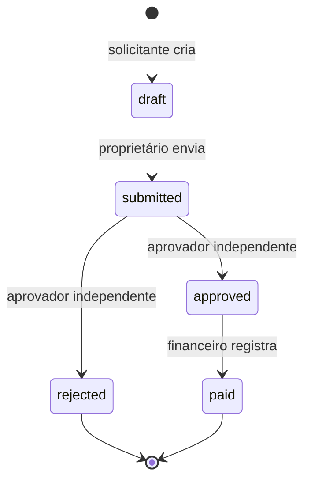

# Aprovação API

Fluxo de despesas corporativas com NestJS, JWT e isolamento entre empresas. O foco é impedir que uma pessoa aprove sua própria despesa, enxergue dados de outro tenant ou registre a mesma liquidação duas vezes.



## Regras verificáveis

| Papel | Permissões |
|---|---|
| requester | Criar, consultar e enviar as próprias despesas |
| approver | Consultar despesas da empresa e aprovar/rejeitar solicitações de outra pessoa |
| finance | Consultar despesas da empresa e registrar liquidação de despesa aprovada |
| auditor | Consultar despesas e trilha da empresa |

O tenant e o papel são recuperados da identidade autenticada. O corpo da despesa não aceita tenant, proprietário, estado ou papel. Solicitações fora da empresa ou pertencentes a outro solicitante retornam 404.

Os comandos de transição exigem a versão vista pelo cliente. Duas decisões sobre a mesma versão resultam em uma mudança válida e um conflito 409. Estado e trilha de auditoria são persistidos na mesma transação. Os valores são inteiros em **centavos de BRL**.

## Executar localmente

Requer Node.js 24+ e npm. O SQLite usa o módulo nativo do Node, sem instalação de banco ou chave de serviço externo.

```powershell
npm ci
npm run setup
npm run build
npm start
```

O comando `setup` cria um `.env` com segredos aleatórios e preserva um arquivo já existente. O arquivo é ignorado pelo Git. Na janela de outro terminal, rode `npm run demo` para executar um fluxo completo contra a API já iniciada.

- `GET /health` verifica se o processo está disponível.
- `/docs` abre o Swagger interativo.
- `/docs-json` expõe o contrato OpenAPI.
- `npm test` compila e executa testes HTTP reais com bancos temporários.
- `npm run format:check` verifica o padrão Prettier.
- `npm run dev` observa o JavaScript compilado. Rode `npx tsc --watch` em outro terminal para recompilar TypeScript durante o desenvolvimento.

## Docker

Depois de `npm run setup`:

```powershell
docker compose up --build
```

O container roda como usuário `node`, com volume de dados e porta publicada somente no loopback do host. O Dockerfile usa etapas de build e runtime. Os testes locais foram executados no Node 24 do Windows; a execução Docker depende de um daemon disponível.

## Identidade

A API usa **4313**. Swagger: **http://localhost:4313/docs**.

1. `POST /identity/users` provisiona usuários mediante `X-Bootstrap-Key`. Essa é uma interface administrativa para um operador de confiança; a chave não deve ir ao frontend.
2. `POST /identity/login` recebe tenant, e-mail e senha e retorna um JWT de uma hora.
3. No Swagger, use **Authorize** com o bearer token para testar despesas.

As senhas usam scrypt com salt aleatório. Os tokens exigem HS256, emissor e audiência esperados e expiração válida. O papel vem do banco a cada chamada, e não de um papel escolhido pelo cliente. A senha deve ter entre 12 e 128 caracteres.

O login limita dez tentativas por IP por minuto. O armazenamento do limitador é local ao processo e reinicia com ele. A aplicação não confia em `X-Forwarded-For` por padrão; configurar proxies e compartilhar quotas entre réplicas exige uma estratégia de implantação.

`npm run demo` cria uma empresa demonstrativa e quatro usuários, executa o fluxo completo e imprime a auditoria. Usa senhas aleatórias e não as imprime. Os registros são demonstrativos e podem ser inspecionados pelo Swagger com um usuário provisionado manualmente.

## Endpoints

| Método | Rota | Entrada |
|---|---|---|
| POST | /identity/users | tenant, email, password, role |
| POST | /identity/login | tenant, email, password |
| POST | /expenses | description, amountCents |
| GET | /expenses | Até 100 registros acessíveis |
| GET | /expenses/:id | Despesa e auditoria |
| POST | /expenses/:id/submit | version |
| POST | /expenses/:id/approve | version |
| POST | /expenses/:id/reject | version |
| POST | /expenses/:id/pay | version + Idempotency-Key |

## Registro financeiro

O endpoint de pagamento grava um registro local e muda a despesa para `paid` atomicamente. A resposta identifica `simulated: true`. A chave é única por empresa. A repetição com a mesma despesa devolve o mesmo registro; outra despesa com a mesma chave causa conflito.

Esse registro não faz transferência bancária, não chama adquirente e não comprova movimentação financeira. Uma integração real precisaria separar intenção e confirmação externa e reconciliar o resultado antes de marcar a despesa como liquidada.

## Testes

Nove cenários cobrem cadastro administrativo e validação, tokens inválidos/expirados, isolamento entre empresas e proprietários, autorização e versão concorrente, autoaprovação, pagamento repetido, rejeição terminal, persistência após reinício e limite de login.

## Decisões e limites

SQLite mantém a execução simples e as alterações transacionais. As listas retornam no máximo 100 registros, sem paginação por cursor. Não há recuperação de senha, SSO, MFA, edição de identidade, upload de comprovantes ou integração bancária. Para ampliar o sistema, esses recursos precisam de requisitos próprios e novas verificações.

`src/identity.ts` reúne autenticação, provisionamento e guard; `src/approvals.ts` concentra os estados e a autorização do domínio. `src/database.ts` mantém a conexão local. As credenciais de bootstrap têm privilégio sobre todas as empresas e devem ficar restritas à operação administrativa.

Projeto de portfólio de Pedro Igor.

## Evidências locais

- [Contrato OpenAPI exportado da aplicação](docs/openapi.json)
- [Resposta obtida ao executar a demonstração](docs/demo-response.json)

Os identificadores e horários no exemplo são de uma execução local. O fluxo pode ser repetido com o comando de demonstração. O Docker Desktop estava sem daemon na verificação local; apenas a configuração Compose foi validada.
